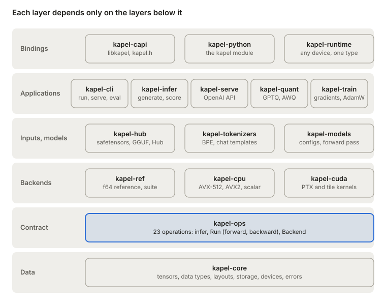

# 2. Architecture at a glance

Kapel is a Cargo workspace of thirteen crates arranged in layers: a tensor type at the bottom, a catalogue of operations above it, interchangeable backends that implement the catalogue, and above them the crates that read files, turn text into tokens, run models and generate text. Each layer depends only on the layers below it.

## The layers

Models sit above the catalogue, never above a particular backend: swapping the reference for the CPU or the GPU changes no model code.

| Layer | Crate | Role | Depends on (Kapel crates) |
| --- | --- | --- | --- |
| Data | `kapel-core` | Tensors, data types, layouts, storage, devices, errors | none |
| Contract | `kapel-ops` | The operation catalogue: shapes, types and checks shared by every backend | core |
| Backends | `kapel-ref` | The reference: every operation in `f64`, and the conformity suite | core, ops |
|  | `kapel-cpu` | The fast CPU backend: AVX-512, AVX2 and portable code | core, ops |
|  | `kapel-cuda` | The CUDA backend, behind the `cuda` feature | core, ops, cuda-abi |
|  | `kapel-cuda-abi` | Types shared by host code and device kernels | none |
| Files | `kapel-hub` | safetensors, GGUF, checkpoints, Hub downloads | core |
| Text | `kapel-tokenizers` | `tokenizer.json`, BPE, decoding, chat templates | none |
| Models | `kapel-models` | Configurations and the transformer forward pass | core, ops, hub |
| Applications | `kapel-infer` | Generation: pipeline, cache, sampling, streaming text | core, ops, hub, models, tokenizers |
|  | `kapel-cli` | The `kapel` command | all of the above |
|  | `kapel-serve`, `kapel-train` | Placeholders for the server and for training | none yet |

Outside the workspace, `kernels/` holds the simple CUDA kernels written in Rust for the nightly compiler. They are compiled once to PTX and the result, `crates/kapel-cuda/kernels.ptx`, is checked in, so the published crates build on stable Rust. `fuzz/` holds the fuzzing targets and `tools/parity/` the Python scripts that produce reference outputs from `transformers`.

Two dependency choices are deliberate. `kapel-tokenizers` depends on no other Kapel crate, so it can be used alone. And no crate above the backends names a backend: models and the generation engine are generic over `B: Backend`, so the same model code runs on the reference, the CPU or the GPU.

## One trait, three backends

The central idea is the split between *what* an operation computes and *how*. `kapel-ops` defines each operation as a small struct with a documented mathematical definition and an `infer` method that checks inputs and computes the output's shape and type. A backend implements `Run<Op>` for each operation: a `forward` and a `backward`. The trait `Backend` is simply the set of all twenty-two `Run` implementations, plus two traits for generation: `Write`, which writes rows into a cache in place, and `Record`, which records a pass once and replays it (a CUDA graph on the card).

Because every backend calls the same `infer` first, every backend accepts and rejects the same calls with the same errors. Because the reference defines the numbers, the CPU and CUDA backends can be tested operation by operation against it, forward and backward, with tolerances that depend only on the data type.

## The life of a request

Follow `kapel run Qwen/Qwen3-0.6B --prompt "Hello"` from the command line to the screen.

1. **Find the files.** `kapel-hub` resolves the repository on the Hugging Face Hub, downloads the configuration, tokenizer and weights into a cache keyed by commit, and verifies checksums. A local directory skips this step.
2. **Open the checkpoint.** `Checkpoint::open` maps the safetensors files into memory. No weight is copied yet: tensors point into the mapped file.
3. **Build the model.** `Model::load` reads `config.json` into a `Config` and looks up each weight by name. `Model::upload` moves the weights to the backend's device, and `Model::cast` converts them, for instance to bf16 on a GPU.
4. **Prepare the text.** `Tokenizer::from_file` reads `tokenizer.json`; `ChatTemplate::from_dir` reads the Jinja chat template. The user's message is rendered by the template, then encoded into token ids.
5. **Prefill.** `Model::step` runs the whole prompt at once through every layer and writes each layer's keys and values into a `Cache`, kept by pages of 16 positions. It returns the logits of the last position.
6. **Decode.** A token is chosen from the logits, greedily or by sampling with the filters of `generation_config.json`; greedy choice runs on the backend (`ArgMax`), so only the token comes back. It is fed back one position at a time, each step reading the cache through `PagedAttention`. On a backend that records, the step is recorded on the first token and replayed for the next ones.
7. **Stream the text.** Each token is decoded to text. Incomplete UTF-8 characters, and text that might be the start of a stop sequence, wait until they are settled, so the text that reaches the screen is never taken back.

Every step of the forward pass is an operation from the catalogue, run by the chosen backend. The rest of the book walks through these layers from the bottom up.
